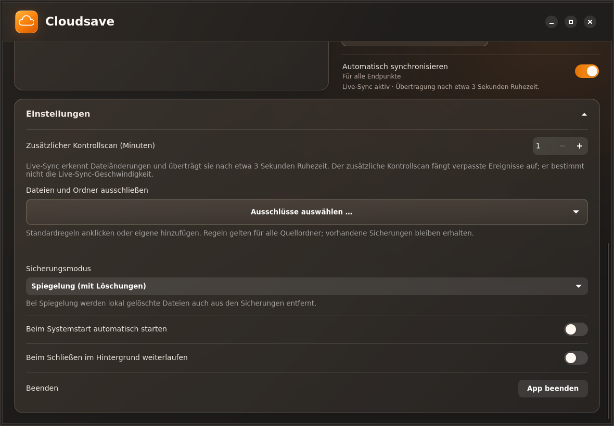
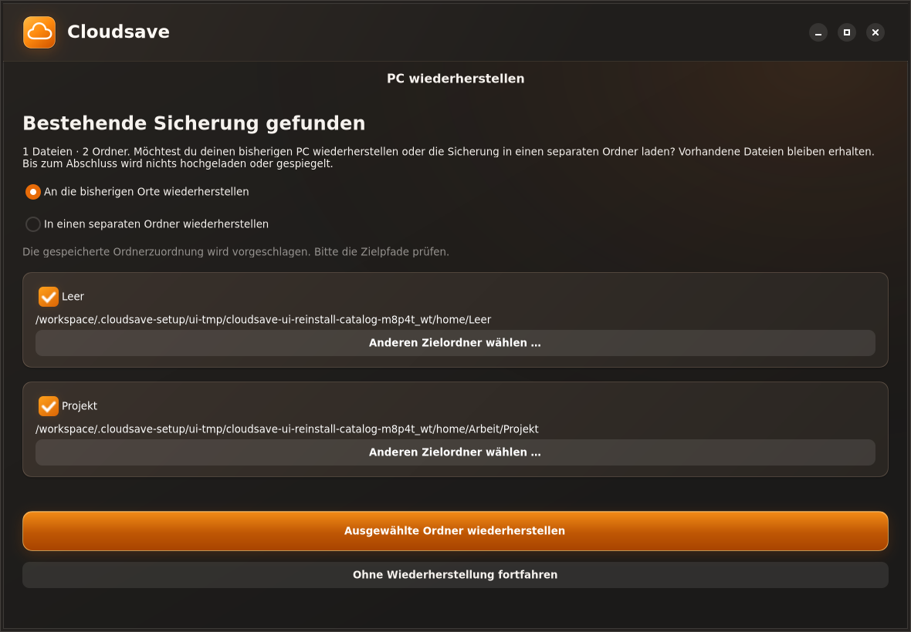
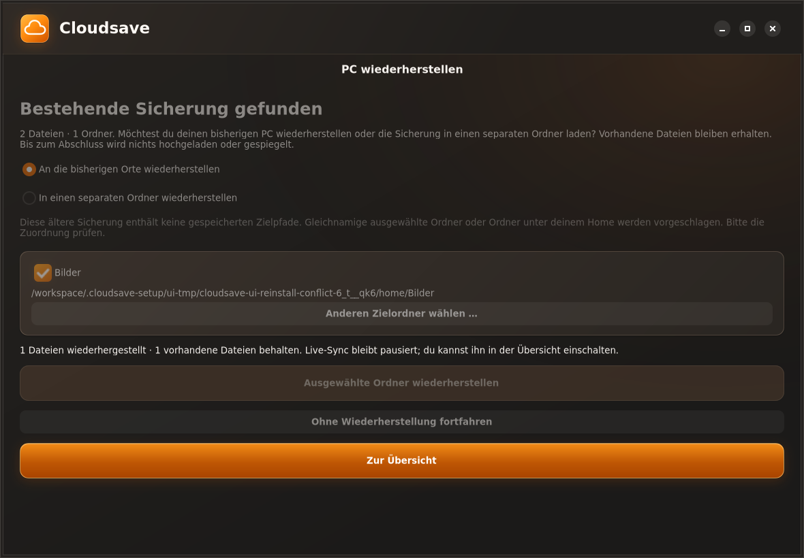

# Warmes Dashboard mit Orange-Akzenten

Die Gestaltung orientiert sich am Mockup: dunkle, warme Flächen, ein
orangefarbenes Statusband, drei Kennzahlenkarten, große Bereiche für Quellen
und Ziele sowie Einstellungen über die gesamte Breite. Verläufe, dünne warme
Konturen und dezente Schatten erzeugen den Glow. Hover- und Fokuszustände sind
sichtbar; es gibt keine dauerhaft pulsierende Dekoration.

Die Bilder zeigen die echte native GTK-App mit isolierten Testdateien und einem
lokalen Ziel. Die Zahlen sind aus den tatsächlich ausgeführten Sicherungen
gelesen. Die Darstellung im installierten Flatpak und unter nativem Wayland
bleibt zusätzlich am Desktop zu prüfen.

## Inhalt und Zustände

- Dateizahl und Größe bezeichnen erfasste Sicherungskopien über alle Ziele, nicht
  die gesamte Belegung eines WebDAV-Servers.
- Die Zeitkarte zeigt die letzte erfasste Dateiübertragung. Ein reiner Scan ohne
  Übertragung wird nicht als neuer Transfer ausgegeben.
- Grün markiert einen erfolgreich abgeschlossenen Sync. Fehler erhalten ein
  eigenes Warnsymbol, eine andere Kontur und weiterhin ihre vollständige
  Meldung mit Pfad und Hinweisen zum Wiederholen.
- Lange Pfade werden in der Übersicht gekürzt und sind im Tooltip vollständig
  verfügbar. Die Auswahl der Quellen und das Verhalten der Synchronisierung
  bleiben erhalten.
- Jeder Endpunkt hat eine eigene Kachel. Verbindungsprüfung und Wiederherstellung
  beziehen sich ausschließlich auf das dort angezeigte Ziel; Rückmeldungen zur
  Verbindung bleiben in derselben Kachel.
- **Weiteren Endpunkt hinzufügen** steht unterhalb aller Endpunkt-Kacheln.
  Auto-Sync ist eine gemeinsame Einstellung und steht separat mit dem Hinweis
  **Für alle Endpunkte**. Es werden keine unabhängigen Schalter pro Ziel
  vorgetäuscht.

## Schmale Fenster und Bedienung

Unter 860 Pixeln wechseln Statusband, Kennzahlen und Inhaltsbereiche in eine
vertikale Anordnung. Die gesamte Seite einschließlich Einstellungen kann
vertikal gescrollt werden. Fokusrahmen erleichtern die Tastaturbedienung;
Outline-Symbole werden direkt gezeichnet und hängen nicht vom Icon-Theme ab.
Das zusätzliche App-Icon aus der Desktop-Fensterdekoration wird unterdrückt;
die eingestellte Position und Reihenfolge der Fensterknöpfe bleibt erhalten.

Die bestehende GTK-Suite prüft außerdem echte Statistikwerte vor und nach dem
Sync sowie ein tatsächlich auf 560 Pixel verkleinertes Fenster (UI-32).
UI-33 prüft getrennte Endpunkt-Kacheln, die Position der Hinzufügen-Aktion,
die gemeinsame Auto-Sync-Einstellung und die zielbezogene Verbindungsprüfung
und Wiederherstellung mit zwei unterschiedlichen Testzielen.

## Ausschlüsse und Live-Sync

Die Einstellungen zeigen zunächst ein kompaktes Auswahlfeld. Ein Klick öffnet
Standardgruppen für Cache-Ordner, temporäre Dateien und Ordner,
System-Vorschaudateien und Entwicklungs-Caches. Jede Auswahl wird sofort
gespeichert; bestehende eigene Regeln bleiben erhalten und lassen sich entfernen.
Keine Gruppe ist ohne vorherige Auswahl aktiv.

**Eigene Regel hinzufügen …** öffnet einen Dialog mit Validierung, beispielsweise
für `*.bak` oder `Projekte/Cache/**`. **Ordner auswählen …** übernimmt einen
Unterordner aus einer gesicherten Quelle ohne Mustereingabe. Sonderzeichen im
gewählten Ordnernamen werden wörtlich behandelt. Die Regeln gelten relativ zu
allen Quellordnern; vorhandene ausgeschlossene Sicherungen bleiben erhalten.

Live-Sync verwendet die vorhandene Dateisystemüberwachung und startet nach etwa
drei Sekunden Ruhezeit einen Sync. Die Oberfläche zeigt aktiv, pausiert oder
eingeschränkt an. Das frühere Sync-Intervall heißt **Zusätzlicher Kontrollscan
(Minuten)**: Es fängt verpasste Ereignisse auf und bestimmt nicht die Wartezeit
der automatischen Änderungserkennung. Pro gebündeltem Lauf scannt die Engine
weiterhin Dateimetadaten; übertragen werden nur geänderte Dateien.

UI-26 prüft Standardgruppen, eigene Regeln, Validierung, Entfernen und Persistenz.
UI-27 prüft reale automatische Dateiübertragungen und Pausieren. UI-34 erzwingt
eine Desktop-Dekoration mit zusätzlichem Icon und unterschiedlich angeordneten
Fensterknöpfen. UI-35 verwendet die native Ordnerauswahl, prüft ungültige Pfade
und sichert, dass ein Ordner mit Glob-Sonderzeichen exakt ausgeschlossen wird.

## Tray und geführte Wiederherstellung

Header und Tray verwenden denselben Renderer für die orange Wolke. Der Tray
liefert vier ARGB-Größen direkt an das Panel, unabhängig von dessen Icon-Theme
und Zugriff auf Flatpak-Dateien. Ein normaler Klick öffnet auf kompatiblen Panels
das native Menü mit aktiven Aufträgen und den letzten acht Jobs dieser Sitzung.

Vorhandene Sicherungen öffnen im Setup einen Assistenten für ganze Ordner.
Die Auswahl zwischen bisherigen Orten und separater Ausgabe steht über den
bestätigbaren Zielpfaden. Dateioperationen laufen im Hintergrund; Fehler lassen
die Einrichtung pausiert und wiederholbar. Nach erfolgreicher Wiederherstellung
zeigt eine Abschlussmeldung die Anzahl geladener und beibehaltener Dateien an.

